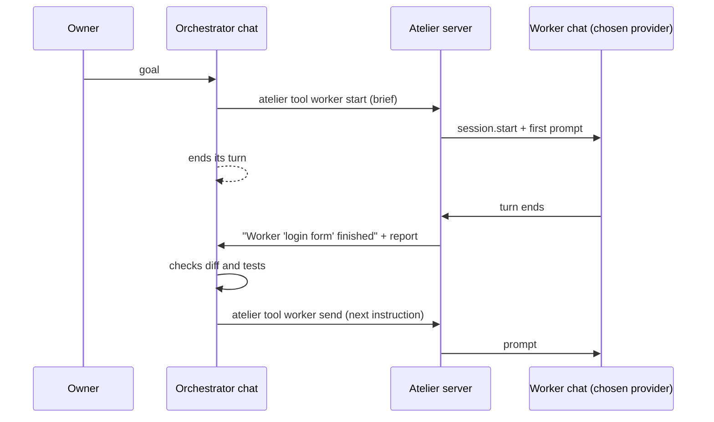

# Orchestrator chats and worker chats

Task #29. Design only; the build tasks are listed at the end.

## The problem

Codex writes good code but needs to be led. It stops partway, doesn't say
what is left, and can't be given a goal and left alone. Claude is better at
planning, keeping track and judging results. The owner wants one chat to own
a goal and hand the coding to workers running on another provider, with the
owner choosing that provider and account.

## How it works

1. In the chat bar, the owner sets **Workers** to a provider and account
   (or **None**). That chat becomes an orchestrator, and can be changed back
   at any time.
2. The owner gives the orchestrator a goal. It plans the goal, then starts
   worker chats with `atelier tool worker start`. Each worker gets a written
   brief.
3. Workers are ordinary Atelier chats on the chosen provider and account. The
   owner can open, watch, type into or stop any of them.
4. When a worker's turn ends, Atelier posts a short report into the
   orchestrator chat. That wakes the orchestrator even if its own turn has
   ended.
5. The orchestrator checks the work (diff, tests, the running app), then
   sends the worker its next instruction, starts another worker, or finishes
   the item. It keeps going until the goal is done or it needs the owner.

## Decisions

### Settings and data

- **The orchestrator setting lives on the session.** A new optional field
  `workers` on `Session` (`server/src/workbench/store.rs`) holds
  `{brand, profile_id, model?, effort?}`. A chat with this field set is an
  orchestrator. It is set by `session.start` and can be changed later from
  the chat's settings, in the same place as model and effort.
- **Worker chats link to their orchestrator.** A new optional field
  `parent_session_id` on `Session`. A worker keeps `begun_by = "person"` so it
  stays visible; `"agent"` chats are hidden from the sidebar
  (`store.rs:1149`), which would defeat the point.
- **The owner's choice is binding.** The worker tool takes its provider,
  account and model from the orchestrator's `workers` field. The orchestrator
  cannot pick a different provider or account. This is the control a skill
  could not give.
- **Any provider can be the orchestrator.** The tool is a shell command, so
  Claude, Codex or another provider can drive it. Claude is the expected
  choice; nothing ties the feature to it.

### The worker tool

A new `atelier tool worker` command, added beside `chat` and `present` in
`server/src/workbench/cli.rs`, with a route under `/api/workbench/workers`:

| Command | What it does |
|---|---|
| `worker start --title T [--brief FILE]` | Starts a worker chat in the orchestrator's folder; the brief is read from the file or standard input and sent as the first message. Prints the worker's chat ID. |
| `worker send ID [--message FILE]` | Sends the next instruction. If the worker is mid-turn, the message is held and sent when the turn ends. |
| `worker list` | This orchestrator's workers: title, state, turn count, last activity. |
| `worker read ID [--all]` | The worker's last reply, or its whole transcript, as text (reuses the `@chat:` text export). |
| `worker stop ID` | Stops the worker's turn. |

- The calling chat is found from `ATELIER_CHAT_SESSION_ID`, which is already
  set on every provider process (`acp/client.rs:2554`).
- The server refuses `worker` commands from a chat without the `workers`
  setting, and refuses `send`, `read` and `stop` on a worker that belongs to
  another orchestrator.
- Starting a worker copies the server-side start-chat sequence that tasks
  already use (`routes/workbench/tasks.rs:675`): `session.start` with the
  stored brand, profile and model, then a rename, then the brief through
  `tell_chat`.
- **One running worker per folder.** Tasks forbid extra worktrees, so workers
  share the orchestrator's folder. Two workers editing one folder at once
  would overwrite each other. `worker start` and `worker send` refuse while
  another worker in the same folder is mid-turn. Idle workers can stay open,
  so a worker keeps its context for follow-ups.

### Reports into the orchestrator chat

- **Turn end is detected from `session.state` events.** A small background
  loop subscribes to `database.subscribe_all()` and watches worker sessions,
  the same way phone notifications do (`push.rs:250`). It records each
  worker's last state. When a worker moves from a mid-turn state
  (`status.rs:46`) to `idle`, `waiting_for_agents`, `errored` or `stopped`,
  that turn has ended.
- **Delivery reuses `tell_chat`** (`routes/workbench/tell.rs:11`), the path
  task answers use. If the orchestrator is idle, the report starts its next
  turn, launching its provider process if needed. If it is mid-turn, the
  report is held and sent when that turn ends. Nothing is lost.
- **The visible part is a short label**, such as `Worker "login form"
  finished` or `Worker "login form" stopped with an error`, following the
  owner's preference for terse app notes. The details go in a block added
  by Atelier (`metadata::added_by_atelier`), which the provider reads and the
  owner's view hides. The block holds the worker's chat ID, end state, turn
  number and final reply (trimmed to a few thousand characters), plus a
  pointer to `worker read` for more.
- **Several workers finishing together** produce one held message each. They
  are sent one per settle, as held messages already are.
- **The owner typing into a worker** is fine. Its next turn end is reported
  the same way, and the report notes that the owner sent the last message,
  so the orchestrator knows the brief changed.

### Role guidance

Both roles get an extra section in their system prompt, added next to the
open-tasks section (`session_policy::with_open_tasks`), keyed by session ID.
The section is applied at connect and whenever guidance is re-sent.

**Orchestrator section** (short; the details live in a built-in reference
skill read on demand):

- You own the goal. Turn the owner's request into a plan, record it as a
  task with checks, and see it through.
- Hand the bulk of the implementation to workers. You may edit files
  yourself when it is quicker than writing a brief: plans, tests, a small
  fix, a finishing touch.
- Write each brief to stand alone: goal, why, where to start, acceptance
  checks, what's out of scope.
- After starting or messaging a worker, end your turn. Atelier wakes you
  with its report.
- Treat a report as a claim. Check the diff, run the checks and exercise the
  change before accepting it.
- Never just say "continue". Send back the exact failing check or missing
  piece, or split the item. After three send-backs without progress, change
  the approach or ask the owner.
- Ask the owner only for decisions that are theirs.

**Worker section:**

- You were started by an orchestrator chat. Do the brief, and nothing
  beyond it.
- Run the acceptance checks before you finish.
- End every turn with a short report under fixed headings: Done, Left,
  Blocked, Files changed, Checks run.
- Don't create tasks; the orchestrator owns them. Put questions under
  Blocked instead of asking the owner.

### Tasks

The orchestrator holds the task, and workers do not hold tasks. This fits
the rule that a chat holds one task in progress. The task's items are the
plan, and their checks are what the orchestrator verifies against. The
orchestrator ticks items with `atelier task check` as workers' work turns
them green. Creating a task still needs the owner's `@task` or an approved
proposal, so the owner approves the plan once at the start. That is the
right moment for the owner to see it.

### How it looks

- **Sidebar:** workers are not rows of the chat list, like subagents. A
  worker whose orchestrator is not in the list stays a row of its own.
- **Orchestrator's right rail:** a Workers section next to Subagents,
  listing each worker with its state and a link to open it.
- **Worker's right rail:** a "Worker of …" link back to the orchestrator.
- **Stopping:** stopping the orchestrator stops only its own turn. Workers
  keep running and their reports are held. A "Stop workers" action in the
  Workers section stops them all.

## Options considered

1. **A skill that runs `codex exec` from the shell.** Rejected. It was built
   and tested, then dropped. The owner can't choose the provider or account,
   the work is hidden in a shell log, and the loop dies when the
   orchestrator's turn ends.
2. **The provider's own subagents (Claude's Task tool).** Rejected. They
   always run the same provider and account as the parent, which is exactly
   what the owner wants to change.
3. **Worker chats started by Atelier, with reports posted into the
   orchestrator chat.** Chosen. It gives provider and account control, makes
   workers visible and steerable, and wakes the orchestrator whatever state
   its turn is in. It reuses start-chat, `tell_chat`, held messages and
   `session.state` events, all of which already exist.
4. **The orchestrator waits on a blocking `worker wait` command run in the
   background.** Rejected as the main way of waking up. It works only while
   the orchestrator's turn is still alive, and only on providers that
   re-invoke the agent when a background command exits. It may still be
   added later for a provider that prefers it.
5. **A hook that blocks the orchestrator from writing files.** Rejected. The
   owner considers it overreach. Guidance steers the bulk of the coding to
   workers instead.
6. **An outside orchestration framework that drives the provider CLIs.**
   Rejected. It would duplicate Atelier's sessions, accounts, transcripts and
   notifications, and the owner couldn't see or steer the workers in the app.

## Open questions

- **More than one worker choice per orchestrator?** For example, Codex for
  the bulk work and Claude for reviews. The design allows a list later; the
  first version has one.
- **A spending limit?** A cap on worker turns per orchestrator, after which
  it must ask the owner. Proposed default: no cap, with turn counts shown in
  the Workers section.
- **Parallel workers.** One running worker per folder is safe but slow. The
  owner could allow worktrees for worker chats later, though that runs
  against the current tasks rule.
- **Approving each worker's tool use.** Workers start with the owner's usual
  permission mode for that provider. Should orchestrator-started workers
  default to auto-approve inside the folder?

## Proposed tasks

| Type | Title | Why |
|---|---|---|
| feature | Worker chats: the `workers` setting, the `parent_session_id` link, and `atelier tool worker` start, send, list, read and stop | The base everything else builds on |
| feature | Post each worker's turn-end report into its orchestrator chat as a short label with the report attached | Lets the orchestrator work unattended |
| feature | Orchestrator and worker role sections in the system prompt, with a built-in reference skill for the orchestrator | Tells each chat its job and how to do it |
| ui_feature | Workers option in the new-chat dialog (provider, account, model), remembered like the other defaults, and changeable in chat settings | Where the owner makes the choice |
| ui_feature | Workers kept out of the chat list, a Workers section in the right rail, and a link back from each worker | Lets the owner see and steer the workers |
